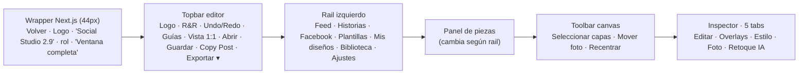
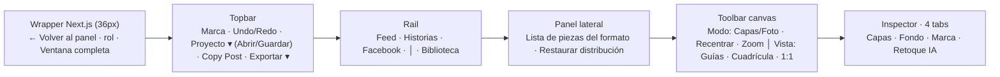

# Plan de Optimización UI · Social Studio 2.9

> **Ejecutor previsto:** Gemini 3.8 Flash (subejecución por fases).
> **Archivo objetivo principal:** `data/social-studio/Roggero_Roma_Social_Studio_2_9.html` (~3,3 MB, una sola página con CSS + JS inline).
> **Archivo secundario:** `app/admin/social-studio/page.jsx` (wrapper Next.js).
> **Fecha:** 2026-11-02 · **Estado:** propuesto, pendiente de ejecución.

---

## 0. Reglas obligatorias para el ejecutor

1. **Producción:** no ejecutar `pull`, `reset`, `checkout`, `clean`, `force push`. **No hacer commit/push sin autorización explícita del usuario.**
2. **No tocar** `assets/fonts/cormorant/` (untracked preexistente) ni `.env*`.
3. **No modificar** el bloque `<script id="rrPreload" type="application/json">` (línea ~485, ~3 MB en una sola línea). Nunca leerlo completo: usar scripts Node con `indexOf` para saltearlo.
4. **No cambiar** el formato de proyecto (`RoggeroRomaSocialStudio-v3`), `saveJson()`, `loadProject()`, ni la lógica de render (`drawCanvas`, `drawLayer`, `cloud`, `ai*`). Este plan es **solo de UI/IA de navegación**: mover, fusionar y eliminar puntos de acceso duplicados.
5. Ediciones: preferir `edit_file` con fragmentos únicos. Para reemplazos sobre líneas gigantes usar un script Node en `<appDataDir>/brain/<conv>/scratch/` (PowerShell rompe comillas en `node -e`).
6. **Después de cada fase:**
   - Validar sintaxis de los 3 `<script>` (JS con `new vm.Script`, el JSON con `JSON.parse`).
   - `npm.cmd run build` debe terminar con código 0.
7. Al final: documentar en `PROJECT_CONTEXT.md` §8 (una viñeta) y pedir autorización para commit/push.

---

## 1. Diagnóstico: mapa actual y duplicados

### 1.1 Estructura actual



### 1.2 Tabla de duplicados detectados

| # | Función | Puntos de acceso actuales | Cant. |
|---|---|---|---|
| D1 | **Guías / márgenes** | Topbar `#toggleSafe` · Editar → sección «Guías» (`#viewSafe`) · Rail Ajustes → `data-side="guides"` | 3 |
| D2 | **Vista cuadrada 1:1** | Topbar `#toggleSquare` · Editar → «Guías» (`#viewSquare`) | 2 |
| D3 | **Abrir / Guardar proyecto** | Topbar `#openJsonBtn` / `#saveJson` · Rail «Mis diseños» → `data-side="open"` / `"save"` | 2 |
| D4 | **Cargar fotografía** | Editar → «Fotografía» `photoUpload` · Estilo → «Encuadre» `photoUpload` · Biblioteca `data-side="upload"` · drag&drop · Ctrl+V | 5 |
| D5 | **Mover encuadre** | Toolbar `#movePhoto` · Editar → `photoMove` · Estilo → `photoMove` | 3 |
| D6 | **Recentrar foto** | Toolbar `#recenterPhoto` · Estilo → `recenter` | 2 |
| D7 | **Zoom foto** | Editar → «Fotografía» slider · Estilo → «Encuadre» slider | 2 |
| D8 | **Alineación de texto** | Editar → sección «Alineación» (`data-aligntext`) · `drawLayerFields` (`data-aligntext`) | 2 |
| D9 | **Botón CTA (colores, ancho, alto, tamaño)** | Editar → sección «Botón CTA · Tamaño y Colores» (`data-ctafield`) · `drawLayerFields` cuando CTA seleccionado (`data-lfield`) | 2 (código duplicado) |
| D10 | **Centrar horizontal** | `drawLayerFields` «Centrar X» · «Alinear capas → Centro» | 2 |
| D11 | **Naranja de marca** | Estilo → «Identidad» · Rail Ajustes (solo texto + botones que redirigen a Estilo/Overlays) | 2 |
| D12 | **Selección de piezas** | Rail Feed/Historias/Facebook · Rail «Plantillas» (lista las 11 piezas otra vez) | 2 |
| D13 | **Branding del header** | Wrapper Next.js (logo + «Social Studio 2.9» + «Social Media Development» x2) · Topbar del editor (logo + R&R + nombre) | 2 headers |
| D14 | **Pestañas de foto separadas** | «Overlays» y «Foto» (filtros) son la misma área conceptual (fondo); «Foto» además tiene una nota inútil «Contraste de textos» | 2 tabs |
| D15 | **Wrapper con naranja viejo** | `page.jsx` usa `#f6931c` / `#F6931C` (el corporativo ahora es `#F26B2E`) | inconsistencia |

**Conclusión:** el rail «Ajustes», «Mis diseños» y «Plantillas» no aportan funciones propias; son atajos a cosas que ya existen. La pestaña «Estilo» mezcla foto (encuadre) con marca (color, tipografías, logo está en Editar). El inspector «Editar» es muy largo porque contiene CTA, logo, alineación, capas, campos, foto y guías a la vez.

---

## 2. Arquitectura objetivo

**Principio:** *cada función tiene un único lugar canónico*; las acciones globales van arriba, las de vista junto al lienzo, las de contenido en el inspector contextual.



### 2.1 Asignación canónica (después)

| Función | Lugar único | Elimina |
|---|---|---|
| Abrir / Guardar proyecto | Topbar → menú **«Proyecto ▾»** (`#projectMenu`) | Rail «Mis diseños» |
| Exportar | Topbar «Exportar ▾» (sin cambios) | — |
| Copy Post | Topbar (sin cambios) | — |
| Guías · Cuadrícula · Vista 1:1 | **Toolbar canvas**, grupo «Vista» (toggles) | `#toggleSafe`/`#toggleSquare` de topbar, sección «Guías» del inspector, `data-side="guides"` |
| Modo capas / mover foto · Recentrar · Zoom | **Toolbar canvas**, grupo «Modo» (+ slider zoom compacto) | Sliders/botones de foto en Editar y Estilo |
| Cargar foto / reutilizar foto | Tab **Fondo** (botón «Cargar fotografía») + Rail **Biblioteca** (reutilizar) + drag&drop/Ctrl+V | botón en Editar y en Estilo |
| Filtros (brillo/contraste/saturación) + 4 overlays | Tab **Fondo** (secciones colapsables) | tabs «Overlays» y «Foto» |
| Capas, campos de capa, CTA, alineación de texto y de grupo | Tab **Capas** (contextual a la selección) | sección CTA dedicada, sección «Alineación» separada |
| Naranja de marca · Logo · Tipografías | Tab **Marca** | tab «Estilo», rail «Ajustes», sección «Logo» en Editar |
| Restaurar distribución de la pieza | Panel lateral (pie de la lista de piezas) | botón en Estilo |
| Portada FB: reutilizar foto del feed | Tab **Fondo** (solo visible si `facebook()`) | sección en Editar |
| Selección de piezas | Rail Feed/Historias/Facebook | Rail «Plantillas» |

---

## 3. Fases de ejecución

Cada fase es independiente y deja la app funcional. Ejecutar en orden.

### Fase 1 · Topbar y menú «Proyecto» (D3)

1. En la topbar (línea ~431, `<div class="top-actions">`): reemplazar `#openJsonBtn` y `#saveJson` por un dropdown reutilizando las clases existentes `.dropdown` / `.dropdown-menu`:
   ```html
   <div class="dropdown"><button id="projectMain">Proyecto ▾</button>
     <div id="projectMenu" class="dropdown-menu">
       <button data-project="open">Abrir proyecto JSON…</button>
       <button data-project="save">Guardar proyecto JSON</button>
     </div></div>
   ```
2. En los handlers (línea ~1183): reemplazar `$('#saveJson').onclick` / `$('#openJsonBtn').onclick` por:
   - `$('#projectMain').onclick=()=>$('#projectMenu').classList.toggle('open');`
   - `$$('[data-project]').forEach(b=>b.onclick=()=>{$('#projectMenu').classList.remove('open');b.dataset.project==='save'?saveJson():openFile('fileJson');});`
   - Cerrar ambos menús (`#exportMenu`, `#projectMenu`) al hacer clic fuera (revisar si ya existe un listener global para `#exportMenu` y extenderlo).
3. Quitar `#toggleSafe` y `#toggleSquare` de la topbar **solo en la Fase 2** (no antes, para no romper `updateToolBtns`).

**Aceptación:** abrir/guardar funciona desde el menú; el nombre de archivo sigue con timestamp.

### Fase 2 · Toolbar del canvas como centro de «Vista» y «Modo» (D1, D2, D5, D6, D7)

1. En `.canvas-toolbar` (línea ~444) dejar dos grupos:
   - **Modo:** `#chooseLayer` («Capas»), `#movePhoto` («Mover foto»), `#recenterPhoto` (⟲), y un zoom compacto `<input id="toolbarZoom" type="range" min="1" max="3" step="0.01">` + lectura `#zoomOut`.
   - **Vista:** `#toggleSafe` («Guías»), nuevo `#toggleGrid` («Cuadrícula»), `#toggleSquare` («1:1»). **Mover** estos botones desde la topbar (mismos IDs → los handlers siguen funcionando).
2. Handlers:
   - `#toggleGrid` → `showGrid=!showGrid;updateToolBtns();render();`
   - `#toolbarZoom` input → `markHistory();p().zoom=+value;` actualizar `#zoomOut`; `render()`.
   - En `updateToolBtns()` agregar: `active-btn` para `#toggleGrid` según `showGrid`, `#toggleSafe` según `showGuides`, y sincronizar `#toolbarZoom.value=p().zoom` (también llamar al cambiar de pieza: `syncAll` ya llama a `updateToolBtns`).
3. Eliminar del inspector:
   - Sección «Guías» completa en `drawInspector` → panel `edit` (`#viewSafe`, `#viewSquare`, `#viewGrid`) y sus ramas en el listener `change` (`viewSafe`, `viewSquare`, `viewGrid`).
   - Sección «Fotografía» de `edit` (Elegir imagen / Mover encuadre / Zoom).
4. CSS: separador visual entre grupos (`.canvas-tools .sep{width:1px;height:20px;background:var(--line);margin:0 6px}`), con override en el tema oscuro.

**Aceptación:** Guías, Cuadrícula, 1:1, Modo, Recentrar y Zoom funcionan solo desde la toolbar; no quedan referencias a `#viewSafe/#viewSquare/#viewGrid` (`grep`).

### Fase 3 · Rail y panel lateral (D11, D12, D3)

1. Rail (líneas ~433-442): eliminar botones `data-nav="templates"`, `data-nav="files"`, `data-nav="settings"`. Mantener `feed`, `stories`, `facebook`, separador, `library`. Renombrar la etiqueta `RECURSOS` → mantener.
2. `drawPieces()` (línea ~558): eliminar ramas `templates`, `files`, `settings`. Si `sidebarView` tiene un valor eliminado, forzar `'studio'`.
3. Handler `#pieces` click (línea ~1188): eliminar ramas `save`, `open`, `style`, `overlays`, `guides`; mantener `upload` (Biblioteca).
4. Handler `[data-nav]` (línea ~1184): eliminar casos de las vistas quitadas.
5. Al pie de la lista de piezas en vista `studio`, agregar `<button class="side-action" data-side="restore">Restaurar distribución de esta pieza</button>` → en el handler: `doAction('restore')`.
6. Mantener `#photoDropHint` solo en la vista `library` (hoy está fijo en el aside).

**Aceptación:** el rail tiene 4 botones; Biblioteca permite importar y reutilizar; no hay vistas huérfanas.

### Fase 4 · Inspector: de 5 a 4 tabs (D4, D8, D9, D10, D11, D14)

Nuevas tabs en `.inspect-tabs` (línea ~445): `data-panel="edit"` → etiqueta **«Capas»**, `data-panel="background"` → **«Fondo»**, `data-panel="brand"` → **«Marca»**, `data-panel="ai"` → **«Retoque IA»**. Eliminar `overlays`, `style`, `filters`.

**4.a · Tab «Capas» (`panel==='edit'`)** — orden final:
1. **Capas** (lista `#layerList` + Subir/Bajar + «Seleccionar todas»). Agregar chip rápido «CTA» junto a «Seleccionar todas» (`data-do="selectCTA"`).
2. **Alinear capas seleccionadas** (`data-alignlayers`): mostrar **solo si `picked.length>1`**.
3. **Editar elemento** (`#layerFields`): es la **única** fuente de alineación de texto (`data-aligntext`), CTA y nube.
4. Eliminar: sección «Botón CTA · Tamaño y Colores» (`data-ctafield`, `data-ctacheck`, `paste-cta`), sección «Alineación» separada, sección «Logo», sección «Fotografía», sección «Guías», sección Facebook (va a Fondo).
5. En `drawLayerFields` cuando `l.type==='cta'`: la casilla «Capa visible» ya cubre «Mostrar botón CTA». Verificar que los 3 sliders + colores + «⚡ A todos los CTA» siguen presentes (ya existen).
6. Quitar «Centrar X» de `drawLayerFields` si `picked.length>1` ya ofrece «Centro»; con una sola capa mantener «Centrar X / Centrar Y» (es la única vía para 1 capa) → **mantener** y eliminar en cambio el duplicado solo si se muestra simultáneamente.
7. Limpieza de listeners: eliminar ramas `data-ctafield` (input) y `data-ctacheck` (change) y la acción `paste-cta` (click) **después** de confirmar con `grep` que no hay más emisores.

**4.b · Tab «Fondo» (`panel==='background'`)** — reúne foto + overlays:
1. «Fotografía»: botón «Cargar / cambiar fotografía» (`data-do="photoUpload"`), nota «También podés arrastrarla o pegarla con Ctrl+V». Si `facebook()`: selector `#fbSourcePhoto` + «Usar foto seleccionada» (mover desde Editar).
2. «Ajustes de imagen»: sliders brillo/contraste/saturación (`slider(...)` existentes) + «Restablecer filtros».
3. «Overlays»: las 4 secciones actuales (general, superior, títulos, inferior) + «Restablecer overlays».
4. Eliminar la nota «Contraste de textos» (redundante: la nube está en Capas).
5. Usar `<details open>` / `<summary>` por sección para acortar el scroll (estilizar `summary` como `h3`).

**4.c · Tab «Marca» (`panel==='brand'`)**:
1. «Naranja de marca» (`#brandColor`, `#brandRead`, «Restaurar #F26B2E»).
2. «Logo» (mover tal cual desde Editar: `#logoPreview`, `logoUpload`, `restoreLogo`, `#whiteLogo`, `#removeLight`). `renderLogoPreview()` debe llamarse también en este panel.
3. «Tipografías» (mover desde Estilo: `fontReg`, `fontBold`, `resetFonts`).
4. Texto informativo de formato (hoy en Estilo → «Composición editorial»): una línea al pie.

**4.d · Código:** en `drawInspector()` reemplazar ramas `overlays`/`style`/`else(filters)` por `background` y `brand`. Buscar con `grep` cualquier `inspectTab('style'|'overlays'|'filters')` y redirigir a `brand`/`background`.

**Aceptación:** 4 tabs; ningún control aparece en dos lugares; todos los IDs movidos (`#brandColor`, `#whiteLogo`, `#removeLight`, `#fbSourcePhoto`) siguen funcionando porque sus listeners son delegados en `#inspectBody`.

### Fase 5 · Wrapper Next.js (D13, D15)

En `app/admin/social-studio/page.jsx`:
1. Reducir header a `h-[36px]` y dejar: «← Volver al panel» · badge de rol · «Ventana completa». **Eliminar** logo, «Social Studio 2.9», doble «Social Media Development» y el texto con punto pulsante (ya están en la topbar del editor).
2. Reemplazar `#f6931c` / `#F6931C` / `from-[#f6931c] to-[#d97706]` por `#F26B2E` (clases arbitrarias Tailwind).
3. Ajustar el contenedor del iframe a `h-[calc(100vh-36px)]`.

**Aceptación:** un solo bloque de marca visible; build OK.

### Fase 6 · Pulido y verificación

1. `grep` final de huérfanos: `viewSafe|viewSquare|viewGrid|data-ctafield|data-ctacheck|paste-cta|data-nav="templates"|data-nav="files"|data-nav="settings"|panel==='overlays'|panel==='style'|openJsonBtn|id="saveJson"` → 0 resultados (salvo comentarios).
2. Revisar los textos de ayuda (`#sideHelp`, `.mini-info`) que mencionen «Estilo», «Overlays», «Ajustes» o «Mis diseños» y actualizarlos a «Marca»/«Fondo».
3. Validar scripts + `npm.cmd run build`.
4. Prueba manual sugerida al usuario (no automatizable): cambiar entre Feed/Historias/FB, seleccionar CTA, mover foto, zoom, 1:1, guardar/abrir JSON, exportar PNG, retoque IA (panel abre).

---

## 4. Riesgos y mitigaciones

| Riesgo | Mitigación |
|---|---|
| Líneas gigantes (`rrPreload`, `OFFICIAL_LOGO`) saturan la lectura | Leer siempre con rangos de línea y `ByteOffset`; nunca `read_file` sobre 485/493 sin límite. |
| Handlers que referencian IDs eliminados lanzan `null` | Mover elementos conservando IDs; al eliminar, borrar también su handler y verificar con `grep`. |
| `updateToolBtns()` usa `#toggleSquare` | Moverlo a la toolbar (Fase 2) en lugar de borrarlo. |
| Undo/redo del zoom en toolbar crea demasiado historial | Usar `markHistory()` solo en `pointerdown`/`change`, no en cada `input` (o replicar el patrón actual del slider de zoom). |
| Usuarios acostumbrados a la ubicación anterior | Toast una única vez al cargar: «Nuevo diseño: Fondo = foto y overlays · Marca = color, logo y tipografías». |

## 5. Resultado esperado

- Topbar: 5 controles (Undo, Redo, Proyecto ▾, Copy Post, Exportar ▾).
- Rail: 4 botones (antes 7).
- Inspector: 4 tabs (antes 5) y el tab principal ~40 % más corto.
- 15 duplicados eliminados; cero cambios en el formato de proyecto ni en el render/exportación.
